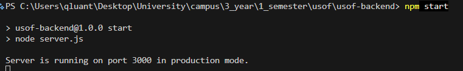
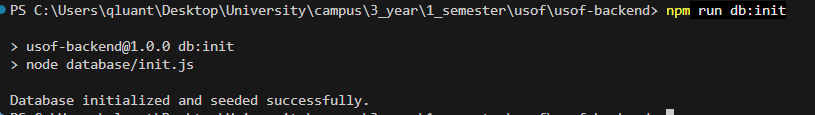
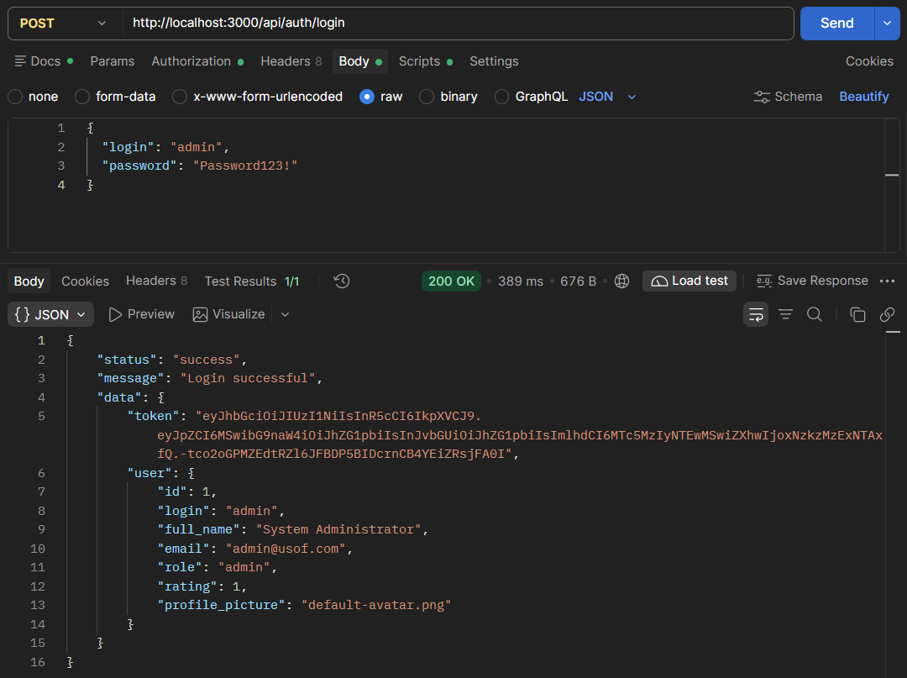
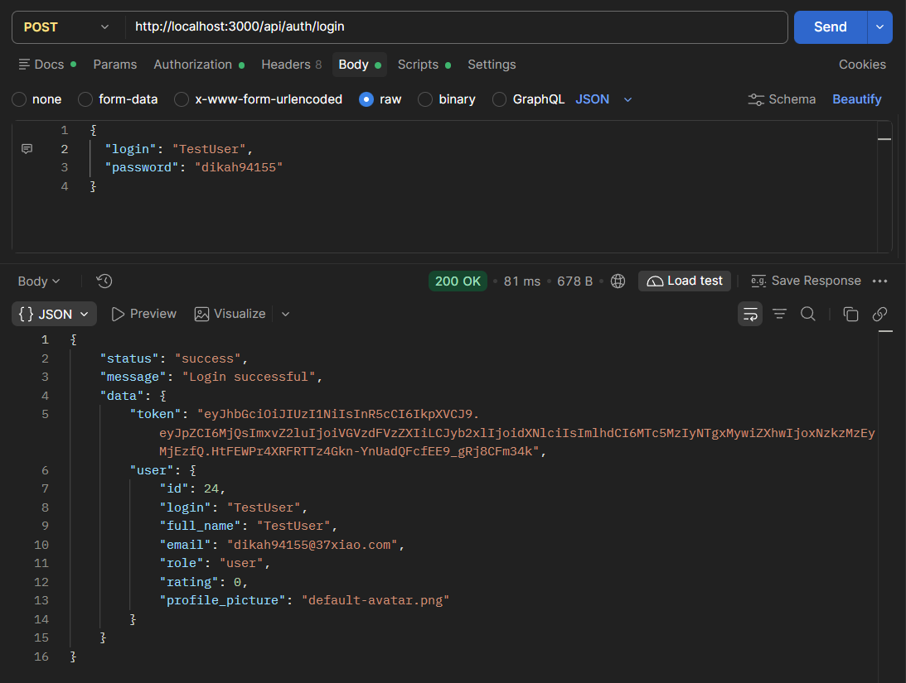
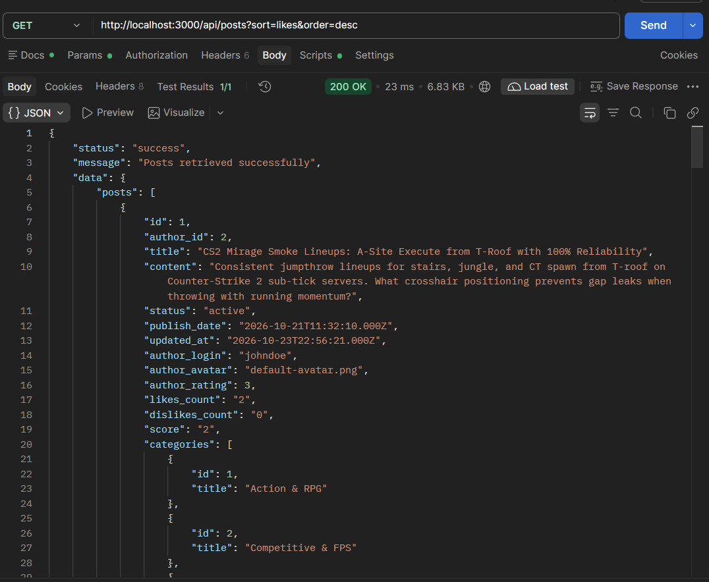
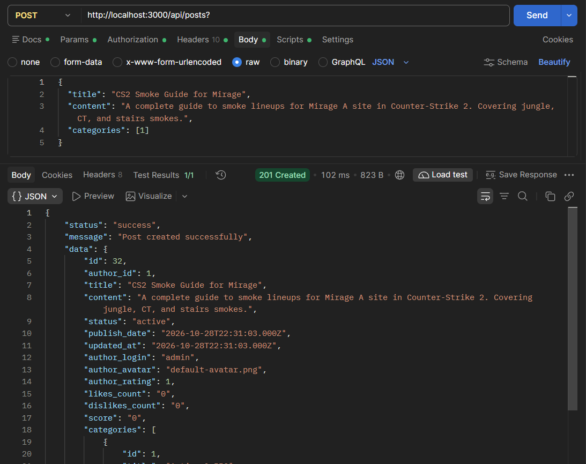
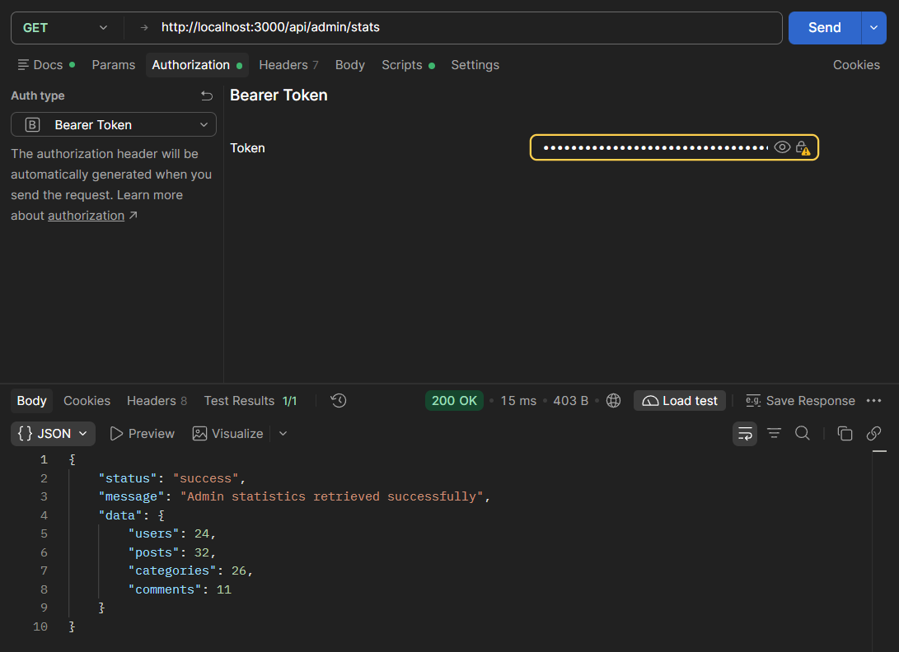
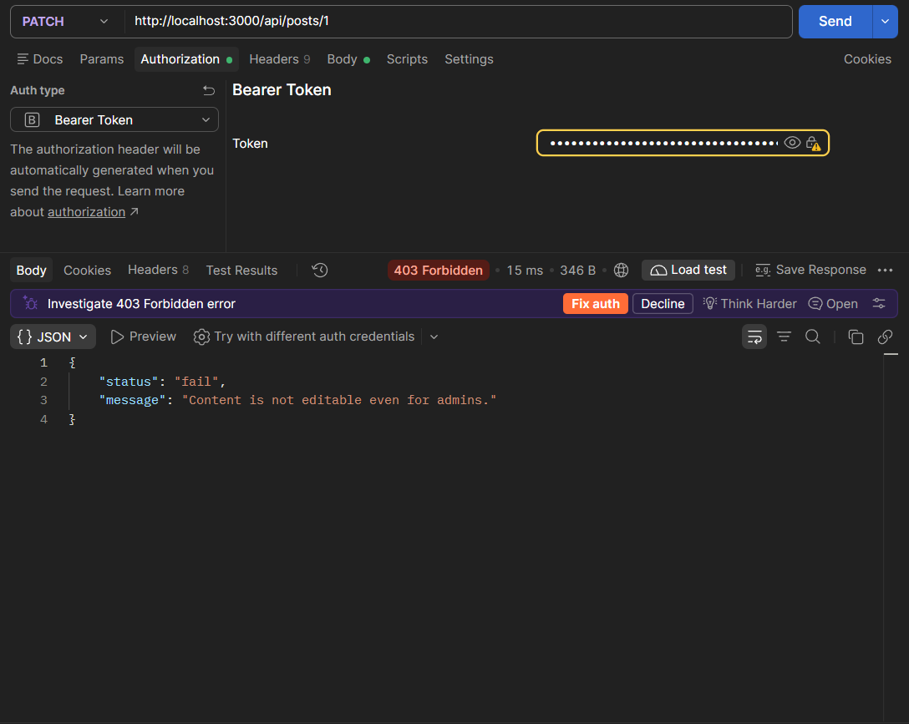

# GamerEars Backend

REST API for GamerEars - a Stack Overflow-style gaming community platform: game discussions, build guides, boss tactics, categories, comments, voting, roles (`user` / `admin`), email verification, and password reset.

## Features

- JWT authentication (Bearer token)
- Email confirmation via SMTP before login
- Password reset via email token
- Full CRUD for users, posts, categories, comments, and likes
- Role-based access control (`user` vs `admin`)
- Moderation with content immutability for admins (admins can lock/unlock status and change categories; content is immutable)
- Sorting (by likes / date, asc / desc) and filtering (by category, author, status)
- Dynamic XP / rating calculation based on likes minus dislikes on user posts and comments
- Avatar image uploads with Multer
- Favorites system for saving posts

## Screenshots

















## Requirements

- Node.js 18+
- MySQL 8+

## Setup

```bash
cp .env.example .env
# edit DB_* credentials, JWT_SECRET, and SMTP settings in .env

npm install
npm run db:init
npm start
```

Development mode with auto-reload:

```bash
npm run dev
```

API base: `http://localhost:3000/api`  
Uploaded avatars: `http://localhost:3000/uploads/avatars/`

### Seed Accounts

| Role  | Login         | Password     | Rating |
|-------|---------------|--------------|--------|
| admin | admin         | Password123! | 520 XP |
| user  | shadow_hunter | Password123! | 45 XP  |
| user  | valkyrie_pro  | Password123! | 215 XP |

## Quick Test

```bash
# Login
curl -X POST http://localhost:3000/api/auth/login \
  -H "Content-Type: application/json" \
  -d "{\"login\":\"shadow_hunter\",\"password\":\"Password123!\"}"

# List posts (public, sorted by likes by default)
curl "http://localhost:3000/api/posts?sort=likes&order=desc"

# Create new post (replace YOUR_TOKEN)
curl -X POST http://localhost:3000/api/posts \
  -H "Authorization: Bearer YOUR_TOKEN" \
  -H "Content-Type: application/json" \
  -d "{\"title\":\"CS2 Smoke Guide\",\"content\":\"Lineups for Mirage A site\",\"categories\":[6]}"
```

## API Endpoints

### Auth
| Method | Path | Description | Access |
|--------|------|-------------|--------|
| POST | `/api/auth/register` | Register new account (`login`, `password`, `password_confirmation`, `email`) | Public |
| GET | `/api/auth/confirm-email/:token` | Confirm email address | Public |
| POST | `/api/auth/login` | Login with credentials (`login` or `email`, `password`) | Public |
| POST | `/api/auth/logout` | Invalidate session | Auth |
| POST | `/api/auth/password-reset` | Request password reset email (`email`) | Public |
| POST | `/api/auth/password-reset/:token` | Set new password with token (`password`) | Public |

### Users
| Method | Path | Description | Access |
|--------|------|-------------|--------|
| GET | `/api/users` | List all users | Auth |
| GET | `/api/users/:user_id` | Get user profile by ID | Auth |
| POST | `/api/users` | Create user | Admin |
| PATCH | `/api/users/avatar` | Upload profile avatar (multipart `avatar`) | Auth |
| PATCH | `/api/users/:user_id` | Update profile data (`login`, `full_name`, `email`, `role`) | Self / Admin |
| DELETE | `/api/users/:user_id` | Delete user account | Self / Admin |
| GET | `/api/users/favorites` | Get user's favorited posts | Auth |

### Posts
| Method | Path | Description | Access |
|--------|------|-------------|--------|
| GET | `/api/posts` | List posts with pagination, sort, and filters | Public |
| GET | `/api/posts/:post_id` | Get single post details | Public |
| POST | `/api/posts` | Create new post (`title`, `content`, `categories`) | Auth |
| PATCH | `/api/posts/:post_id` | Update post (Author: full; Admin: categories/status only) | Author / Admin |
| DELETE | `/api/posts/:post_id` | Delete post | Author / Admin |
| GET | `/api/posts/:post_id/comments` | List comments for post | Public |
| POST | `/api/posts/:post_id/comments` | Add comment to post | Auth |
| GET | `/api/posts/:post_id/like` | Get post likes and dislikes | Public |
| POST | `/api/posts/:post_id/like` | Vote on post (`type`: like \| dislike) | Auth |
| DELETE | `/api/posts/:post_id/like` | Remove vote on post | Auth |
| POST | `/api/posts/:post_id/favorite` | Add post to favorites | Auth |
| DELETE | `/api/posts/:post_id/favorite` | Remove post from favorites | Auth |

### Comments
| Method | Path | Description | Access |
|--------|------|-------------|--------|
| GET | `/api/comments/:comment_id` | Get comment by ID | Public |
| PATCH | `/api/comments/:comment_id` | Update comment (Author: content; Admin: status only) | Author / Admin |
| DELETE | `/api/comments/:comment_id` | Delete comment | Author / Admin |
| GET | `/api/comments/:comment_id/like` | Get comment likes and dislikes | Public |
| POST | `/api/comments/:comment_id/like` | Vote on comment (`type`: like \| dislike) | Auth |
| DELETE | `/api/comments/:comment_id/like` | Remove vote on comment | Auth |

### Categories
| Method | Path | Description | Access |
|--------|------|-------------|--------|
| GET | `/api/categories` | List all categories with post counts | Public |
| GET | `/api/categories/:category_id` | Get single category | Public |
| POST | `/api/categories` | Create category (`title`, `description`) | Admin |
| PATCH | `/api/categories/:category_id` | Update category | Admin |
| DELETE | `/api/categories/:category_id` | Delete category | Admin |

### Admin
| Method | Path | Description | Access |
|--------|------|-------------|--------|
| GET | `/api/admin/stats` | Dashboard statistics (users, posts, comments, categories counts) | Admin |

## Project Structure

```
usof-backend/
├── config/
│   ├── app.config.js
│   ├── db.config.js
│   └── mail.config.js
├── database/
│   ├── init.js
│   ├── schema.sql
│   └── seed.sql
├── docs/
│   ├── screenshots/
│   └── DOCUMENTATION.md
├── src/
│   ├── controllers/
│   ├── middlewares/
│   ├── models/
│   ├── routes/
│   ├── services/
│   ├── utils/
│   └── app.js
├── uploads/
│   └── avatars/
├── .env.example
├── package.json
└── server.js
```

## Documentation

For the full architectural narrative, CBL engineering stages, and technical decisions, see [docs/DOCUMENTATION.md](docs/DOCUMENTATION.md).

## Notes

- Passwords are encrypted with `bcryptjs` (10 salt rounds).
- Inactive posts and comments are only visible to their author and administrators.
- If SMTP credentials are not specified in `.env`, confirmation links are logged to stdout as a fallback.
